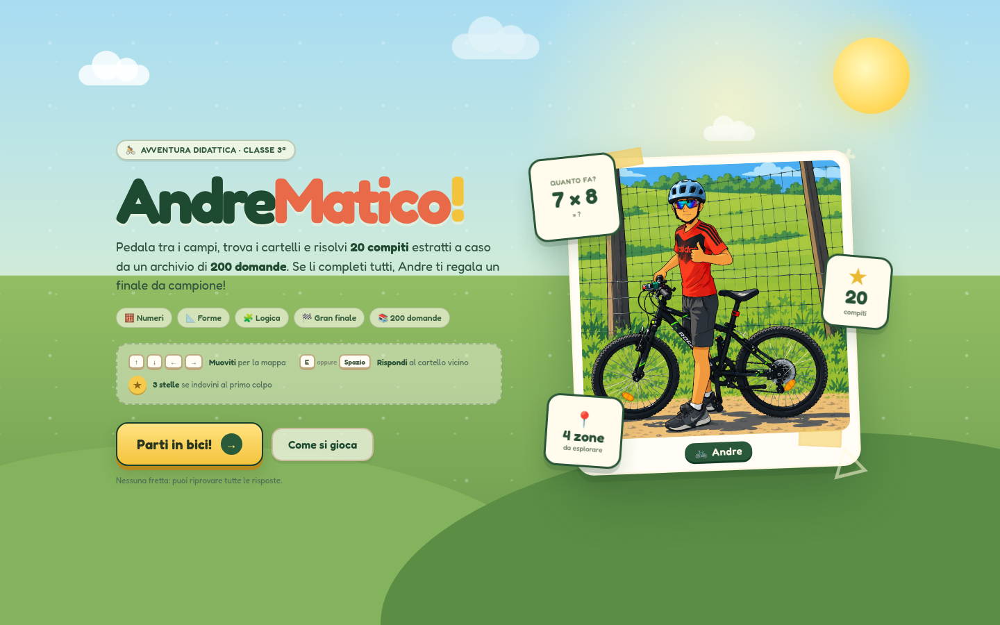
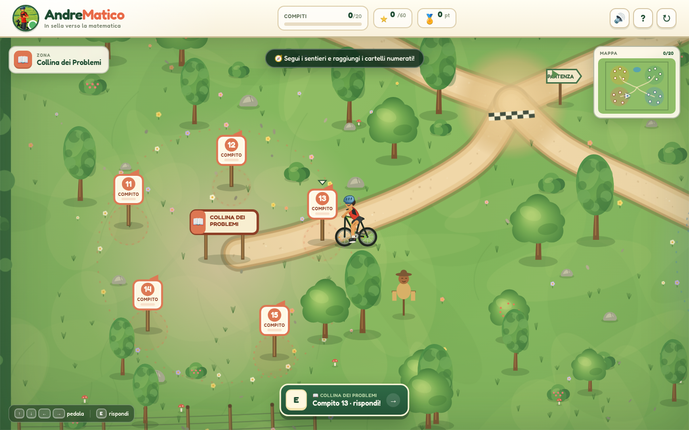
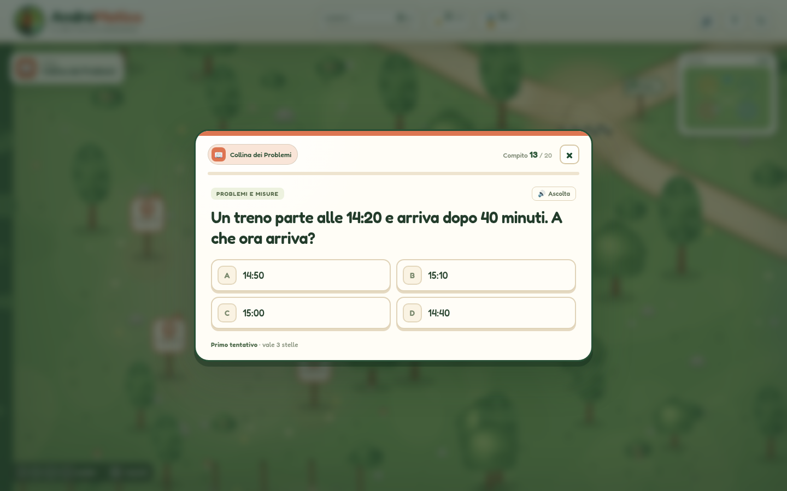
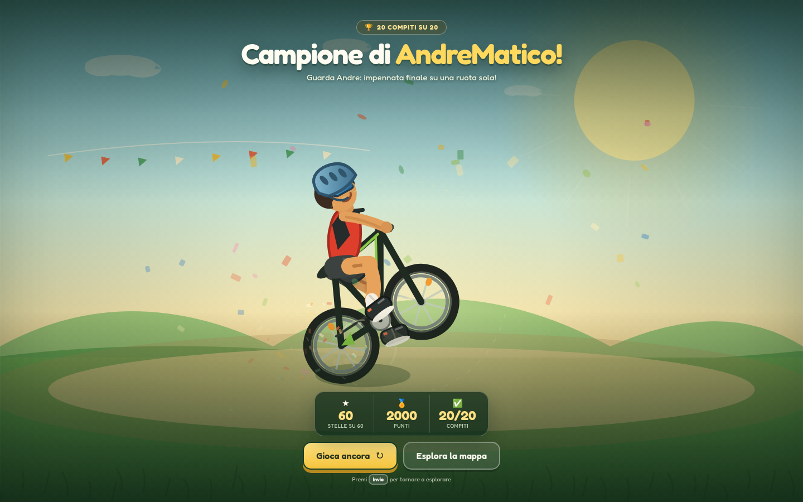

# AndreMatico 🚴

**AndreMatico** è un gioco 2D didattico per la **classe terza della scuola primaria**.
Andre pedala per una campagna illustrata, raggiunge i cartelli numerati e risolve **20 compiti**
di matematica, geometria e logica, estratti a caso da un **archivio di 200 domande**.
Dopo l’ultimo compito arriva il gran finale: un’impennata in equilibrio su una ruota sola!

## Come si gioca

1. Apri `index.html` con un browser moderno. Funziona anche con doppio clic, senza server.
2. Premi **Parti in bici!**.
3. Muovi Andre con le **frecce** (o `WASD`, o il D-pad su touch).
4. Avvicinati a un cartello con un numero e premi **E**, **Spazio** oppure il pulsante **Rispondi**.
5. Scegli una delle quattro risposte. Puoi usare anche i tasti **1–4**.
6. Completa tutti e **20 i compiti** per vedere l’animazione finale. Ogni nuova partita propone un nuovo gruppo di domande.

## Le quattro zone

| Zona | Icona | Compiti |
| --- | --- | --- |
| Prato dei Numeri | 🔢 | Tabelline, addizioni, sottrazioni, divisioni e calcolo |
| Bosco delle Forme | 📐 | Perimetri, aree, poligoni e figure geometriche |
| Collina dei Problemi | 📖 | Problemi con denaro, misure, tempo e situazione |
| Lago della Logica | 💡 | Sequenze, numeri pari, giorni, cubo e ragionamento |

Ogni zona ha **5 compiti**, per un totale di **20** estratti a caso a ogni partita.

## Archivio delle domande

Le domande sono raccolte in `questions.js` e divise in **5 argomenti da 40 domande** ciascuno,
per un totale di **200**:

| Argomento | Domande | Zona in cui vengono usate |
| --- | --- | --- |
| Numeri | 40 | Prato dei Numeri |
| Calcolo | 40 | Prato dei Numeri |
| Geometria | 40 | Bosco delle Forme |
| Problemi e misure | 40 | Collina dei Problemi |
| Logica | 40 | Lago della Logica |

A ogni partita il gioco estrae **5 domande per ogni zona** (per il Prato dei Numeri mescola
numeri e calcolo), le assegna ai cartelli e mescola le risposte. Le domande della partita
precedente non vengono riproposte subito, così una nuova partita parte con un gruppo diverso.
Quando un argomento sta per esaurirsi, l’archivio viene rimescolato automaticamente.

## Punteggio e stelle

| Risposta | Punti | Stelle |
| --- | --- | --- |
| Giusta al primo tentativo | 100 | ★★★ |
| Giusta al secondo tentativo | 70 | ★★☆ |
| Giusta dal terzo tentativo in poi | 50 | ★☆☆ |

- Massimo: **2000 punti** e **60 stelle**.
- Se sbagli, ricevi un suggerimento e puoi riprovare.
- Il record personale viene salvato nel browser con `localStorage`.
- Il pulsante 🔊 attiva o disattiva i suoni.

## Il finale

Quando tutti i 20 compiti sono completati, la mappa lascia spazio a una scena dedicata:
Andre fa un’impennata, pedala in equilibrio sulla ruota posteriore, la ruota gira, arrivano
polvere, scintille e coriandoli. Dalla schermata finale puoi **giocare ancora** o **esplorare
la mappa** completata.

## Comandi

| Azione | Tastiera | Touch |
| --- | --- | --- |
| Muoversi | Frecce / `WASD` | D-pad |
| Aprire il compito vicino | `E` / `Spazio` / `Invio` | Pulsante **Rispondi** |
| Scegliere una risposta | `1`–`4` | Tocca la risposta |
| Chiudere un compito o l’aiuto | `Esc` | Pulsante × |
| Leggere la domanda | Pulsante **Ascolta** | Pulsante **Ascolta** |
| Ricominciare | Pulsante ↻ | Pulsante ↻ |

## Caratteristiche tecniche

- **HTML + CSS + JavaScript puro**, nessuna libreria e nessuna richiesta di rete.
- Mappa grande **2200 × 1700 px** disegnata con Canvas, con camera che segue Andre.
- Personaggio, mountain bike, alberi, cartelli, stagno, campo e paesaggio disegnati con Canvas
  in stile cartoon, ispirati alla fotografia fornita.
- 20 domande con risposte mescolate a ogni apertura, suggerimenti e spiegazioni.
- Mini-mappa, barra dei compiti, stelle, punteggio e feedback accessibile (`aria-live`).
- Effetti sonori sintetizzati con la **Web Audio API** (nessun file audio esterno).
- Lettura della domanda con la **sintesi vocale italiana** del browser, se disponibile.
- Layout responsive per desktop, tablet e telefono; comandi touch integrati.
- Rispetto di `prefers-reduced-motion`.
- Salvataggio del record e della preferenza audio in `localStorage`.

## File

| File | Contenuto |
| --- | --- |
| `index.html` | struttura, schermata iniziale, quiz, aiuto e finale |
| `style.css` | grafica, animazioni, layout responsive |
| `questions.js` | archivio di 200 domande divise in 5 argomenti |
| `game.js` | mondo Canvas, personaggio animato, estrazione domande, logica, audio, finale |
| `assets/ciclista.png` | fotografia originale di Andre usata nella schermata iniziale e nell’HUD |
| `assets/fonts/` | font **Fredoka** in formato WOFF2 + licenza OFL |
| `anteprima*.png` | screenshot del gioco |

## Personalizzare il gioco

- **Domande**: modifica gli array dentro `questions.js`. Ogni voce usa
  `q(testo, opzioni, risposta, suggerimento, spiegazione, diagramma)`; la risposta deve essere
  presente tra le quattro opzioni. Puoi aggiungere altre domande: il gioco pesca casualmente
  dall’archivio.
- **Posizioni dei compiti**: modifica `TASK_POSITIONS` in `game.js`.
- **Colori e zone**: modifica l’oggetto `ZONES` e le variabili in `:root` dentro `style.css`.
- **Aspetto del personaggio**: la funzione `drawRider()` in `game.js` disegna casco blu,
  occhiali, maglia rossa, pantaloncini scuri e mountain bike.
- **Finale**: la scena è disegnata da `drawVictoryScene()` e `drawVictoryBackground()`.

## Crediti

- Personaggio e fotografia di riferimento: immagine fornita dall’utente.
- Font **Fredoka** — The Fredoka Project Authors, distribuito con SIL Open Font License 1.1
  (vedi `assets/fonts/OFL.txt`).
- Suoni generati proceduralmente con Web Audio.
- Grafica Canvas e codice: realizzati per questo progetto.
# Andrematico
# Andrematico
